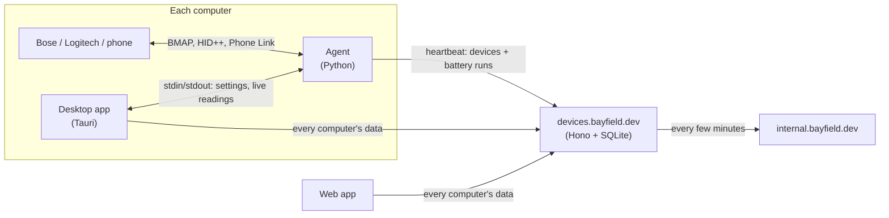

<div align="center">

  

  # Devices

  **The batteries and settings of my wireless devices, from every computer, without any vendor app, cloud or account.**

  [](#️--disclaimer)
  [](LICENSE)
  [](https://react.dev)
  [](https://nodejs.org)
  [](https://www.sqlite.org)
  [](https://www.python.org)
  [](https://devices.bayfield.dev)
</div>


## ⚠️ • Disclaimer

Every device protocol here was **reverse engineered** and is spoken directly to the hardware: BMAP over Bluetooth RFCOMM for Bose, HID++ 2.0 through the Lightspeed receiver for Logitech. Nothing breaks encryption or replays traffic, but writes land on a real device instantly, so use it at your own risk. This is also a personal project built around the devices on my desk, not a polished product: expect missing pieces, sharp edges, and breaking changes.


## 📋 • Table of Contents

- [📖 • Overview](#--overview)
- [🎧 • Supported Devices](#--supported-devices)
- [🧩 • Components](#--components)
- [🛠️ • Tech Stack](#️--tech-stack)
- [🚀 • Getting Started](#--getting-started)
- [🔐 • Sign-in & Security](#--sign-in--security)
- [🔋 • Polling & Battery History](#--polling--battery-history)
- [⌨️ • Keyboard Shortcuts](#️--keyboard-shortcuts)
- [💻 • Command Line](#--command-line)
- [📁 • Project Structure](#--project-structure)
- [🐳 • Docker Deployment](#--docker-deployment)
- [➕ • Adding a Device](#--adding-a-device)
- [📡 • Notes on the Protocols](#--notes-on-the-protocols)
- [🙌 • Credits](#--credits)
- [📄 • License](#--license)


## 📖 • Overview

Devices replaces the Bose Music app and Logitech G HUB for what I actually use them for: seeing how much battery is left, and changing a setting now and then. It is the same app as my other `*.bayfield.dev` apps ([notes](https://notes.bayfield.dev), [calendar](https://calendar.bayfield.dev), [llip](https://llip.bayfield.dev)…): same header, sidebar, side panel, settings and update check, on the web and as a desktop app.

- **An agent on each computer** the devices are connected to talks to them in their own protocol and keeps their battery history. It comes inside the desktop app, which starts it and controls the devices through it.
- **A server** keeps the data of every computer, so the history follows you when you change computers, and copies it to [internal.bayfield.dev](https://github.com/PaulBayfield/internal.bayfield.dev).
- **The app** (web and desktop) shows every device from the server, and changes settings through the agent of the computer it runs on.

Key features:
- Every device of every computer on one page, lowest battery first; low battery and charging lists
- Battery history per device over 24 h to 90 days, with the charging phases, kept across computers
- Bose settings: volume, EQ, noise cancellation modes, wind block, multipoint, voice prompts, sidetone, name; play, pause, pairing mode, power off
- Logitech settings: DPI, report rate, lighting per zone (shown live on a 3D model), host or onboard profile mode
- A linked Android phone's battery, read from what Phone Link already fetched
- Live readings every second while the desktop app is open, pushed by the agent; 30–60 s otherwise
- Desktop app (Windows) with the agent inside: one installer per computer, linked from the app, kept running from the tray and started at sign-in


## 🎧 • Supported Devices

| Device | Vendor | Key | Link | Status |
|---|---|---|---|---|
| QuietComfort 45 headphones | Bose | `qc45` | Bluetooth, RFCOMM channel 8 | Reads, volume and transport controls verified, plus a ModeConfig write |
| SoundLink Micro 2 speaker | Bose | `micro2` | Bluetooth, RFCOMM channel 1 | Reads, volume, power off and pairing verified; mapped from scratch |
| G502 LIGHTSPEED mouse | Logitech | `g502` | Lightspeed receiver `046D:C539` | Battery, DPI, report rate, LEDs, onboard mode |
| Android phone | Phone Link | `phone` | Phone Link's files on Windows | Battery and charging state, read-only |


## 🧩 • Components



| Component | Folder | Runs | Role |
|---|---|---|---|
| Agent | `agent/` | On each computer with devices, started by the desktop app | Polls the devices, keeps their history (SQLite, the offline queue), sends it to the server after every poll, runs what the desktop app asks |
| Server | `server/` | Docker, behind the reverse proxy | Gathers every computer's devices and history in a SQLite file, sign-in, API keys, copy to internal.bayfield.dev |
| Web app | `src/` | Served by the server | The interface: every computer's data, from anywhere |
| Desktop app | `src-tauri/` | Windows | The web app in a window, with the agent inside: starts it, keeps it running from the tray, links the computer, changes the devices' settings |

The agent opens no port: it connects out to the server, and the desktop app talks to it on its stdin and stdout. Devices are never controlled through the server, only through the desktop app of the computer they are connected to; the web app shows the data.


## 🛠️ • Tech Stack

| Layer | Technology |
|---|---|
| Web app | React 19, TypeScript 7, Vite 8 |
| Server | Node 24 running TypeScript directly, Hono 4 |
| Database | SQLite: Node's built-in `node:sqlite` on the server, the agent's history |
| Sign-in | OIDC with Authentik (authorization code + PKCE) |
| Agent | Python 3.14, hidapi, built into one executable with PyInstaller |
| Desktop | Tauri 2 (Rust) |


## 🚀 • Getting Started

### Prerequisites

- Node 24 and npm (web app, server)
- [uv](https://docs.astral.sh/uv/) and Python 3.14 (agent)
- Rust (desktop app only)
- Windows or Linux with Bluetooth for the agent

### Installation

```sh
npm install && npm --prefix server install
cd agent && uv sync
```

### Environment Variables

The server is configured in `server/.env` (copy `server/.env.example`):

| Variable | Description |
|---|---|
| `PUBLIC_URL` | Where the app is reachable, e.g. `https://devices.bayfield.dev` |
| `DATABASE_PATH` | The SQLite file (`server/data/devices.db`; `/data/devices.db` in the image) |
| `OIDC_ISSUER`, `OIDC_CLIENT_ID`, `OIDC_CLIENT_SECRET` | Authentik provider (redirect URI `${PUBLIC_URL}/api/auth/oidc/callback`) |
| `OIDC_ALLOWED_GROUPS`, `OIDC_ADMIN_GROUPS` | Who may sign in, who is admin |
| `DEV_LOGIN_USER` | Local development only: sign in without Authentik (ignored unless `PUBLIC_URL` is localhost) |
| `CLIENT_IP_HEADER` | Header with the visitor IP behind a proxy (`cf-connecting-ip`) |
| `HISTORY_DAYS` | Days of battery history kept on the server (365) |
| `INTERNAL_URL`, `INTERNAL_API_KEY`, `INTERNAL_SYNC_MINUTES` | Copy to internal.bayfield.dev (a key with the `devices:write` scope) |

The desktop app configures its agent itself. Run on its own (a computer without the desktop app), the agent reads `agent/.env` (copy `agent/.env.example`):

| Variable | Description |
|---|---|
| `CENTRAL_URL`, `AGENT_KEY`, `AGENT_NAME` | The server and this computer's key, created in Settings → Computers |
| `POLL_INTERVAL`, `POLL_INTERVAL_MIN`, `POLL_INTERVAL_ACTIVE` | Poll rate: steady (60 s), while a battery moves (30 s), while the desktop app is open (1 s) |
| `HISTORY_PATH`, `HISTORY_DAYS` | Local battery history (SQLite) |

### Running Locally

```sh
cp server/.env.example server/.env     # PUBLIC_URL=http://localhost:8830, DEV_LOGIN_USER=demo
npm run server                         # API on :8830 (creates server/data/devices.db)
npm run dev                            # web app on :1470
npm run agent:build                    # the agent as one executable, for the desktop app
npm run tauri dev                      # the desktop app, which starts the agent
```

In the desktop app: connect with a personal API key from the web app (Settings → Security → API keys), then Settings → **This computer** → **Link this computer**. A browser page opens; approve it while signed in as an admin, and the app gets the computer's agent key on its own.

A computer without the desktop app can still run the agent on its own: Settings → Computers → **Add a computer** in the web app, the key in `agent/.env` (`CENTRAL_URL`, `AGENT_KEY`), then `cd agent && uv run __main__.py serve`.


## 🔐 • Sign-in & Security

- People sign in with Authentik; there are no Devices passwords. The first account is admin.
- **Every API route needs a session or a key**, `/api/health` included. Only the sign-in flow is open.
- **Personal API keys** (`dvc_…`, Settings → Security) are for the desktop app and scripts, and are **read-only**: they read the devices and their history, and can't change anything. Creating keys, adding computers and managing users need a signed-in session, and so does merely listing keys, sessions or users.
- **Agent keys** (`dva_…`, one per computer) can only report that computer's devices, and nothing else.
- Keys and session cookies are random tokens; only their SHA-256 is stored. Cookie-authenticated writes must come from the app itself (`Origin` check).
- The agent opens no port: only the desktop app that started it can talk to it (stdin/stdout).
- Linking a computer: the desktop app opens `/link` with the SHA-256 of a secret it keeps; a signed-in admin approves; the app claims the agent key with the secret. The key is created at that moment and never stored, and an approval nobody claims expires after 10 minutes.
- The desktop app keeps the server address and its key in the OS credential store.
- internal.bayfield.dev receives the data with a key that can only write it (`devices:write`), not read it back. The Bluetooth address is not sent.


## 🔋 • Polling & Battery History

The agent adapts its poll rate, for accurate data without draining the devices over Bluetooth:

| When | Every |
|---|---|
| The desktop app is open and visible on this computer | 1 s (`POLL_INTERVAL_ACTIVE`), discovery every 30 s |
| A battery is charging, at 20 % or less, or just changed | 30 s (`POLL_INTERVAL_MIN`) |
| Everything is steady | 60 s (`POLL_INTERVAL`) |

It sends the server a heartbeat after a poll, at most every 10 s. Readings are stored as **runs**: one row per stretch of polls with the same level and charging state, which keeps months of history in a few thousand rows. The local history is the queue: the server acknowledges what it received, so a computer that was offline catches up at its next report, and the first report backfills everything.

Charging phases are worked out from the runs. A device that doesn't say whether it is charging (Bose) gets its charges inferred from its level going up.


## ⌨️ • Keyboard Shortcuts

| Keys | Action |
|---|---|
| `Ctrl K` or `/` | Search |
| `R` | Poll this computer now |
| `J` / `K` | Next / previous device |
| `Ctrl B` or `\` | Toggle the sidebar |
| `.` | Toggle the side panel |
| `Ctrl ,` | Settings |
| `Esc` | Close, go back |


## 💻 • Command Line

In `agent/`:

```bash
uv run __main__.py                    # battery of every device (the default)
uv run __main__.py battery --json     # the same, in the shape the API uses
uv run __main__.py devices            # everything discovery finds, every vendor
uv run __main__.py serve              # run the agent on its own (poll, history, reports)
uv run __main__.py help
```

### Bose

```bash
uv run __main__.py bose                     # status (the default)
uv run __main__.py bose info                # model, serial, addresses, platform
uv run __main__.py bose volume 8            # stops at 15 without --loud
uv run __main__.py bose eq 3 0 -2           # bass / mid / treble, each -10..+10
uv run __main__.py bose name "Paul's QC45"  # rename over Bluetooth
uv run __main__.py bose multipoint on
uv run __main__.py bose pair                # pairing mode ('pair off' to leave)
uv run __main__.py bose off                 # power down
uv run __main__.py bose probe --mac ...     # map an unknown device, read-only
uv run __main__.py bose help
```

QuietComfort 45 adds `cnc`, `wind`, `mode`, `modes`, `quiet`, `aware`, `profile` and `sidetone`. Options go before the command: `bose --device <key>`, `--mac <address>`, `--channel <n>`, `--timeout <s>`.

### Logitech

```bash
uv run __main__.py logitech info                    # name, battery, DPI, rate, profile mode
uv run __main__.py logitech dpi 1600
uv run __main__.py logitech rate 500
uv run __main__.py logitech led logo static --color ff0000
uv run __main__.py logitech mode host|onboard
uv run __main__.py logitech features                # dump the HID++ feature table
```


## 📁 • Project Structure

```
devices.bayfield.dev/
├── agent/                 # Python agent, run on each computer with devices
│   ├── src/devices/       # Bose (BMAP), Logitech (HID++), Phone Link
│   ├── src/agent/         # polling, history, link to the server, channel to the desktop app
│   └── src/cli/           # command line
├── server/src/            # Hono server: auth, app API, agent API, internal.bayfield.dev sync
├── src/                   # React app: shared shell + devices/ (cards, history, controls)
├── src-tauri/             # desktop app (Tauri)
├── public/                # favicon, device photos and 3D model
├── docs/logo.svg
├── Dockerfile  docker-compose.yml
└── .github/workflows/     # ci, deployment (image), release (desktop installers)
```


## 🐳 • Docker Deployment

The image holds the web app and the server; the agent runs natively on each computer (Bluetooth radio, USB receiver).

```sh
cp server/.env.example server/.env   # PUBLIC_URL, OIDC_*, INTERNAL_*
docker compose up -d
```

The whole database is one SQLite file in the `/data` volume: a backup is a copy of it (`sqlite3 devices.db ".backup copy.db"` while it runs).

Pushing to `main` publishes `ghcr.io/paulbayfield/devices.bayfield.dev` (`latest` and the version) and a GitHub release when the version is new. Pushing a `v*` tag builds the Windows desktop installers and attaches them to that version's release. Put the server behind the reverse proxy at `https://devices.bayfield.dev → localhost:8830`.


## ➕ • Adding a Device

**Bose**

1. **Map it.** `uv run __main__.py bose probe --mac <address> --json captures/new.json` sweeps an unknown device read-only and prints every address that answers.
2. **Write the class** in `agent/src/devices/bose/models/`: subclass `Device`, give it the identity attributes, and build `FEATURES` with `catalog.features()`, naming only what differs from `COMMON`.
3. **Register it** with one line in `agent/src/devices/bose/models/__init__.py`, keyed by the product id `[0.3]` reports.
4. **Check it without the hardware.** `uv run __main__.py bose replay captures/new.json status info paired` feeds the recording back through the class.

**Logitech**

Subclass `HidppDevice` and `core.Device` in `agent/src/devices/logitech/`, set the identity attributes and `MATCH` (a substring of the name the device reports), implement `battery()`, and add the class to `MODELS`. `logitech features` lists what the device supports.

**A new vendor** gets a package under `agent/src/devices/` with a `VENDOR` name and a `scan()` returning `FoundDevice` records, and joins `VENDORS`.

**In the app**, a photo, a gallery or a 3D model goes in `public/` and `src/lib/visuals.ts`. `scripts/transparent_photos.py` removes the white background of product photos.


## 📡 • Notes on the Protocols

### Bose BMAP

A BMAP packet is four header bytes plus a payload: `[function_block, function, flags, payload_length, ...payload]`. `flags` carries the operator in its low nibble. Bose gates SET (operator 0) behind cloud-mediated authentication, but GET (1), SETGET (2) and START (5) are unauthenticated on the Settings, Control and AudioModes blocks, which covers every user-facing setting. **BMAP carries no track metadata**: a device only tells you which address it is playing from.

### Logitech HID++ 2.0

Requests are long reports (`11 <slot> <featIdx> <fn<<4|swId> <params...>`) on the receiver's vendor collection. Feature indexes are looked up through ROOT. Battery is `0x1001 BATTERY_VOLTAGE`: millivolts and no native percentage, so the percentage is interpolated over a Li-ion discharge curve.

### Phone Link

Nothing talks to the phone. Phone Link keeps the linked phone's status on disk for the Start menu's companion panel, and the agent reads the battery and connection state out of it.


## 🙌 • Credits

| Person | Role |
|---|---|
| [Paul Bayfield](https://github.com/PaulBayfield) | Creator & maintainer |

| Dependency / protocol | Used for |
|---|---|
| [React](https://react.dev), [Vite](https://vite.dev) | The web app |
| [Hono](https://hono.dev), SQLite | The server |
| [Tauri](https://tauri.app) | The desktop app |
| [hidapi](https://github.com/trezor/cython-hidapi), [PyInstaller](https://pyinstaller.org) | The Logitech receiver, the agent's executable |
| [model-viewer](https://modelviewer.dev) | The 3D mouse |
| [Lucide](https://lucide.dev) | Icons |
| Bose BMAP (reverse engineered), Logitech HID++ 2.0, Microsoft Phone Link | Talking to the devices |


## 📄 • License

Devices is licensed under the [AGPL 3.0](LICENSE).

```
Devices
Copyright (C) 2026 Paul Bayfield

This program is free software: you can redistribute it and/or modify
it under the terms of the GNU Affero General Public License as published by
the Free Software Foundation, either version 3 of the License, or
(at your option) any later version.

This program is distributed in the hope that it will be useful,
but WITHOUT ANY WARRANTY; without even the implied warranty of
MERCHANTABILITY or FITNESS FOR A PARTICULAR PURPOSE.  See the
GNU Affero General Public License for more details.

You should have received a copy of the GNU Affero General Public License
along with this program.  If not, see <http://www.gnu.org/licenses/>.
```
